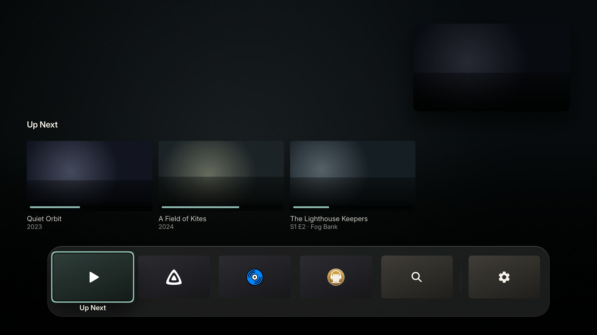
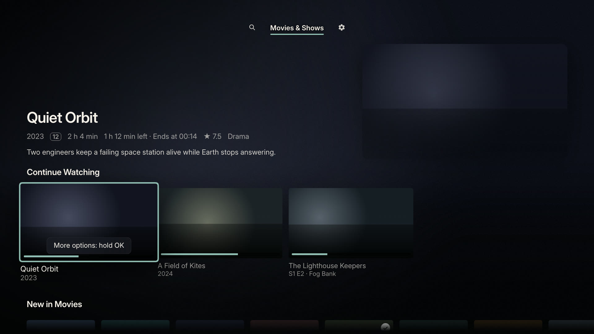
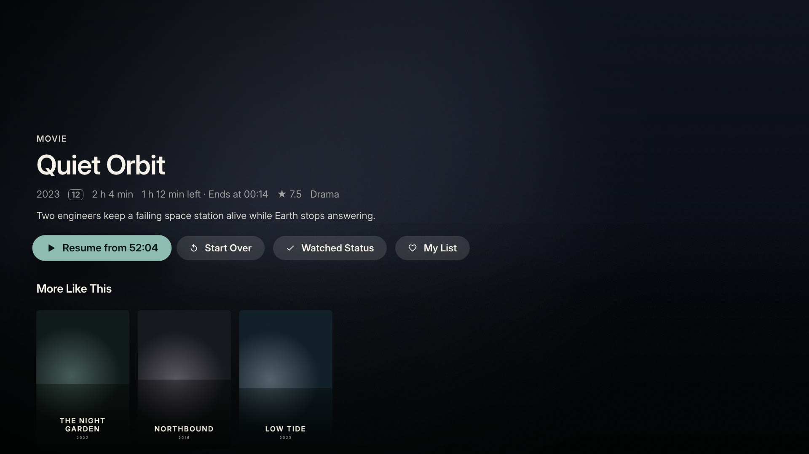

# Matinee

A media center for the TV: a small Linux computer next to the TV, operated with a remote. One UI for movies and shows
from Jellyfin, music from Navidrome, audiobooks from Audiobookshelf and podcasts from Podfetch, with one search across
all of them, and your own library as television channels with a programme guide.



| Movies and shows | A movie |
|---|---|
|  |  |

*The pictures show made-up titles ([how they are made](docs/development.md#screenshots)).*

**Status:** early. In daily use on one thin client since October 2026; expect rough edges. The UI is in English and
German.

## Who it's for

- You keep your films, shows and music on your own server (Jellyfin, and if you like Navidrome, Audiobookshelf,
  Podfetch) and want one calm UI for all of it on the TV, run with a remote.
- You would rather put a used mini PC behind the TV than an Apple TV or a Fire TV stick: no account with anyone, no
  ads, no tracking, nothing from the cloud but the updates.
- You set it up once, for yourself or for your family, and then it simply comes on with the TV.

It is not a server (that stays Jellyfin) and not a streaming app for Netflix and the like.

## What you need

- A small computer for the TV with Debian 13 (trixie) or newer, LMDE 7, Ubuntu 26.04 or newer, Raspberry Pi OS
  (trixie), Arch Linux, Manjaro, EndeavourOS, CachyOS, Fedora, openSUSE Tumbleweed or Leap 16, e.g. a used mini PC with an Intel processor of the 6th generation or newer and 8 GB of memory. Videos its graphics chip cannot decode, Jellyfin converts.
  The least it runs on: 2 cores and 2 GB, even with Jellyfin on it (measured: Jellyfin, Chromium and a 1080p film
  playing together leave about 0.5 GB free). A graphics chip that decodes the videos is what matters: without one,
  a 1080p film drops frames even on 4 cores.
- A [Jellyfin](https://jellyfin.org/) server, or none yet: `install.sh` can set one up on the TV computer itself, and
  `deploy/nas` has one for a NAS ([docs/server.md](docs/server.md)). Optional: [Navidrome](https://www.navidrome.org/) for music,
  [Audiobookshelf](https://www.audiobookshelf.org/) for audiobooks, [Podfetch](https://github.com/SamTV12345/PodFetch)
  for podcasts.
- A remote that shows up as a keyboard (USB or RF remotes, air mice, a Flirc receiver), a Bluetooth remote such as
  Amazon's Fire TV remote, or an Xbox controller (USB or Bluetooth).

The UI is a web app running full screen in Chromium under `cage`; mpv plays the videos. The backend needs nothing but
Python 3.12 or newer.

## Tested on

| System | How | Last checked |
|---|---|---|
| Arch Linux on a Lenovo ThinkCentre M710q (Intel, 7th generation) | in daily use on a TV | November 2026 |
| Ubuntu 26.04 (arm64) | fresh install with `get-matinee`, in a VM | November 2026 |
| Debian 13 (arm64) | fresh install with `get-matinee`, in a VM | November 2026 |
| Fedora 45 (arm64) | fresh install with `get-matinee`, in a VM | November 2026 |
| openSUSE Tumbleweed (arm64) | fresh install with `get-matinee`, in a VM | November 2026 |

The others in the list above install their packages in tests, but have not run Matinee on a real screen. A
Raspberry Pi 5 should work (the VMs are arm64 too); whether its graphics chip plays every video smoothly is untested.

## Install

As the user Matinee is to run as, with a network (a cable, or Wi-Fi set up with the distribution's installer):

```sh
curl -fsSL https://github.com/M0l0k0plv5/matinee-releases/releases/latest/download/get-matinee | sh
```

`get-matinee` fetches the newest package, checks its signature and checksum, unpacks it to `~/.kino-versions` (linked as
`~/kino`) and runs `install.sh`, which asks for the sudo password. Updates come as signed packages too
([docs/setup.md](docs/setup.md#updates)). The rest is optional:

```sh
cd ~/kino
./deploy/boot.sh                    # optional, Arch, Debian, Fedora, openSUSE with GRUB: Matinee's logo instead of boot messages, no GRUB wait
./deploy/pair-remote.sh             # optional: pair a Bluetooth remote (Fire TV: hold Home 10 s first)
./deploy/pair-remote.sh xbox        # optional: pair an Xbox controller by Bluetooth (hold its pair button first)
./deploy/harden.sh                  # optional: watchdog, clean power button, snapshots before updates (Arch, openSUSE)
sudo reboot
```

From the source instead (updates then come with `git pull`): `git clone https://github.com/M0l0k0plv5/matinee ~/kino`,
then `~/kino/deploy/install.sh`.

- **Fedora, openSUSE:** both leave out H.264 and HEVC for their patents, so `install.sh` offers
  [RPM Fusion](https://rpmfusion.org/) or [Packman](https://packman.links2linux.org/) for them (without, Jellyfin
  converts most videos and some do not play).
- **Ubuntu:** Chromium comes as a snap there (`install.sh` installs it). The snap keeps Matinee's Chromium profile in
  `~/snap/chromium`, and Matinee's service runs without `NoNewPrivileges` there (`kino.service.d/snap.conf`), which the
  snap's starter needs; the snap confines Chromium itself. NetworkManager looks after Wi-Fi only on Ubuntu, the cable
  stays with netplan: Wi-Fi is set up on the TV as elsewhere. Linux Mint and LMDE have Chromium as a package of their own;
  Pop!_OS and elementary OS get the snap too (and snapd, which they leave out).
- **Ubuntu 24.04** and those made from it do not work: their mpv (0.37) stops at options of Matinee's player, and
  `install.sh` says so before it installs anything. Linux Mint 22, Pop!_OS 24.04, Zorin OS 18 and elementary OS 8 are
  among them; their versions on Ubuntu 26.04 are expected to (`install.sh` is ready for them, Chromium as a snap).
  Until then, LMDE 7 is the Linux Mint that works.
- **Raspberry Pi OS** (trixie, 64-bit): installs as Debian. `boot.sh` needs GRUB, which a Raspberry Pi does not start
  with: no boot logo there. Whether its graphics chip decodes the videos Matinee plays has not been tried on a Pi yet.

The computer then boots straight into Matinee. The first start goes through a few steps: the language, the network
(Wi-Fi if there is no cable), Jellyfin (the servers found on the network are listed) and a Bluetooth remote; each but
the language can be left for later, and Settings → System → First-Start Setup runs them again. Left for later, open
Movies & Shows: Matinee lists the Jellyfin servers it finds, and the Wi-Fi when there is no network yet. It asks for the Jellyfin server,
your user name and password there (the remote's letter grid or a keyboard). Music, audiobooks and podcasts are set up
the same way in the settings. The terminal works as well: `config.json` and `./set-password`, below. Signing in to
Navidrome, Audiobookshelf and Podfetch, logs, updates and what happens when the network drops:
[docs/setup.md](docs/setup.md).

> **Bluetooth remotes:** `install.sh` sets `ClassicBondedOnly=false` in `/etc/bluetooth/input.conf`, because some
> remotes pair without a key. The price: someone within Bluetooth range pretending to be the remote could type on the
> TV computer. If your remote pairs with a key, set it back to `true`.

## On a Mac

Matinee also runs on macOS as an app in a window; Bluetooth pairing, the display mode and switching off stay on the
TV computer.

```sh
brew install python mpv && brew install --cask ungoogled-chromium
git clone https://github.com/M0l0k0plv5/matinee ~/kino
cd ~/kino
./deploy/macos-app.sh               # ~/Applications/Matinee.app; Cmd+Q closes it; it asks for Jellyfin on first start
```

A second Matinee from another checkout can run beside it: `KINO_NAME="Matinee" ./deploy/macos-app.sh` makes
`~/Applications/Matinee.app`, with a port (8766), settings, Chromium profile and log of its own.

On a Mac Matinee is drawn smaller than on a television (Settings → General → Size: Desk), with more on the screen, and a
video fills the screen at once, without a Space of its own sliding in.

Chromium on macOS opens an empty "New Tab" window beside an app window whenever macOS asks it to reopen (its icon in
the Dock clicked, the app activated again). `newtab-guard` closes those at once in Matinee's own Chromium profile.

Settings → System → Software Updates installs a new version there as well, as long as Matinee's folder has no changes of
its own; a folder you work in is left alone (update it with `git pull`). A desktop (a Mac, a laptop) also updates by
itself once Matinee has not been used for 10 minutes and nothing plays ("Update Automatically", on by itself there; it
looks for a new version once an hour); the TV computer at night.

## Configuration

Matinee writes `~/.config/kino/config.json` itself when you sign in on the TV. By hand it needs only the server and your
user name, then `./set-password` signs in once:

```json
{
  "server": "http://192.168.1.10:8096",
  "username": "me",
  "language": "en"
}
```

Everything else is set on the TV and written back to that file. All keys:
[docs/configuration.md](docs/configuration.md).

## Using it

| Key | Browsing | During playback |
|---|---|---|
| Arrows | Navigate | Left / right: seek; up / down: louder / quieter |
| OK | Open, play | Pause, skip the intro, go to the seek mark |
| Long-press OK | Options for what is chosen | – |
| Back | Back | Close a panel, otherwise stop |
| Menu | Volume | The info panel |

All keys, the player's bar and the info panel: [docs/controls.md](docs/controls.md).

## More

- [Getting started](docs/getting-started.md): the first evening with Matinee, for whoever got the TV computer
- [Handbuch](docs/handbuch.md): the manual for customers, in German
- [A media server](docs/server.md): Jellyfin on the TV computer itself, or on a NAS
- [Features](docs/features.md): everything Matinee does, part by part
- [Setup in detail](docs/setup.md): starting, crashing, network drops, remotes and Bluetooth, signing in
- [Configuration](docs/configuration.md): every setting
- [Security](docs/security.md): what the backend lets in, where tokens are kept
- [Privacy](docs/privacy.md): everything Matinee connects to besides your own servers
- [Development](docs/development.md): tests, screenshots, the layout of the code

## License

[FSL-1.1-MIT](LICENSE) (Functional Source License): use, change and share Matinee freely, for yourself, your family
or the people you set it up for; only selling it, or a product built on it, in competition with Matinee is not
allowed. Two years after each version is published, that version is also under the MIT license.

The font is [Allo](https://allo.joshpuckett.me), built on
[Inter](https://github.com/rsms/inter), under the SIL Open Font License
([web/fonts/license/OFL-Allo.txt](web/fonts/license/OFL-Allo.txt)). The Jellyfin logo on the main menu is from the
Jellyfin project ([jellyfin-ux](https://github.com/jellyfin/jellyfin-ux)), licensed under
[CC BY-SA 4.0](https://creativecommons.org/licenses/by-sa/4.0/).
